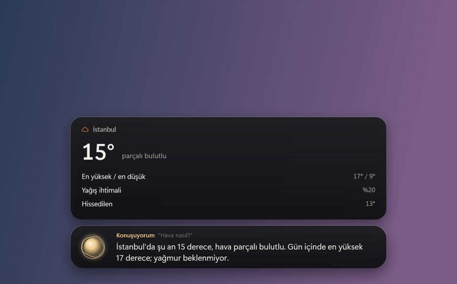
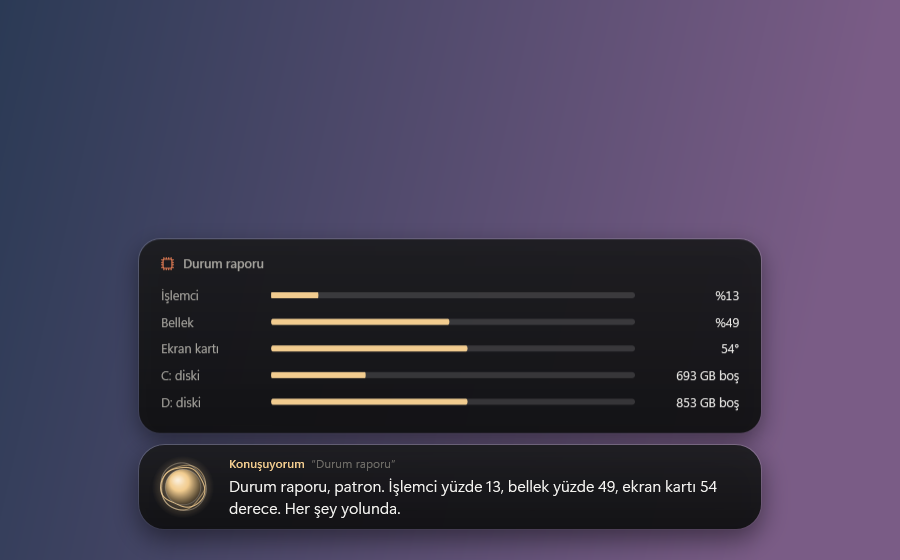
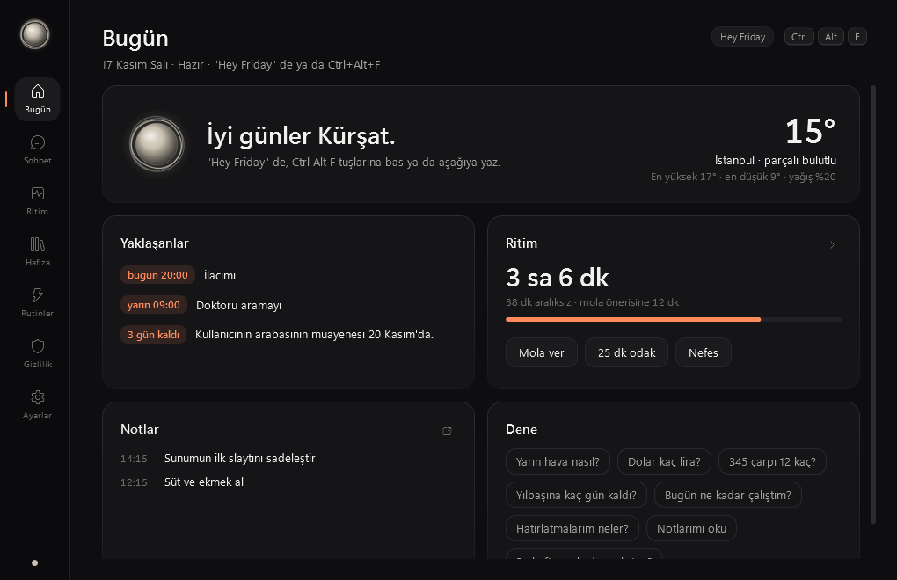
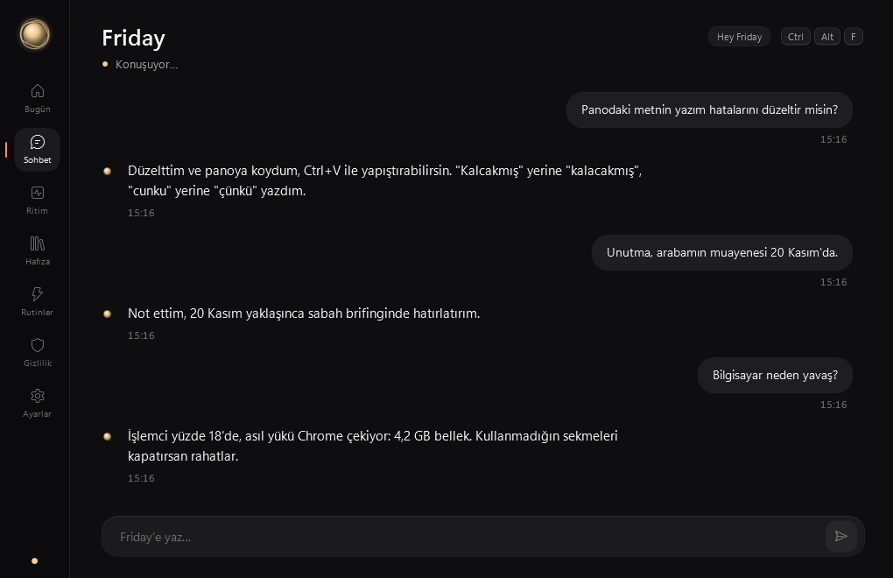
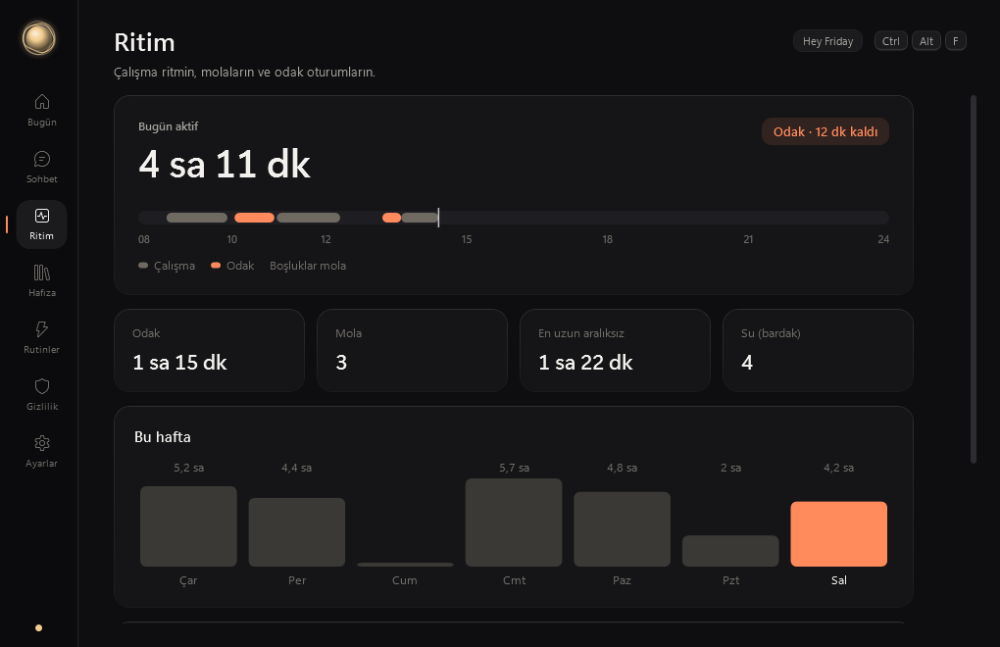
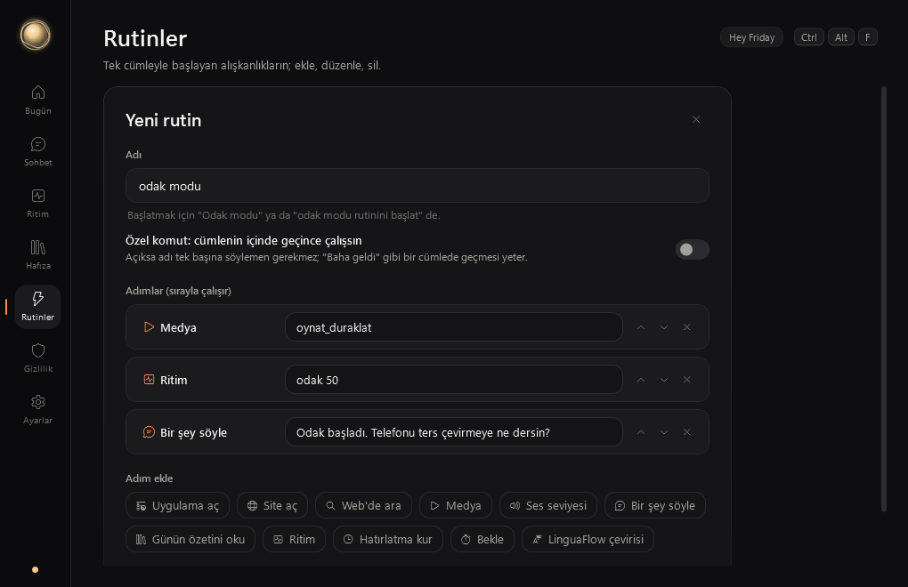
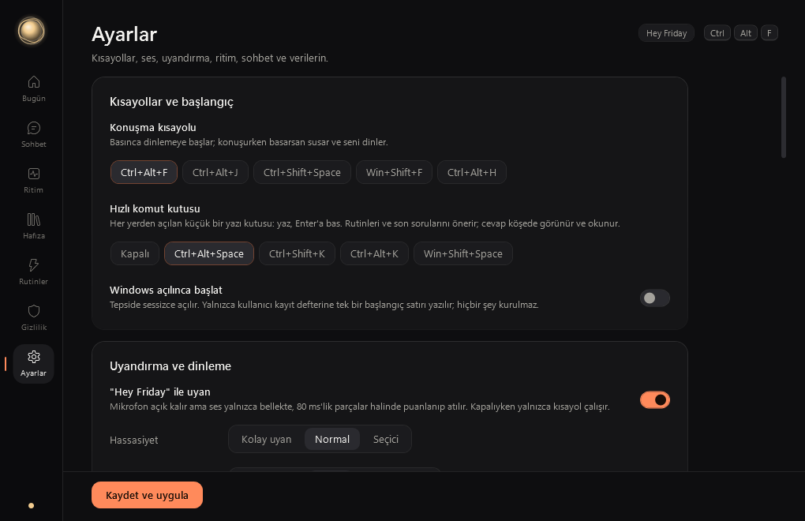

# Friday

Friday, Windows için Türkçe konuşan kişisel bir sesli asistan. **"Hey Friday"** deyince ya da kısayola basınca dinlemeye başlar, sen susunca durur. Uyandırma kelimesi, konuşma tanıma, anlama, düşünme ve konuşma tamamen bilgisayarında çalışır; API anahtarı, abonelik ya da internet gerekmez. Boşta beklerken toplam ~60 MB RAM ve tek çekirdeğin ~%2'sini kullanır.


## Onu farklı kılan şeyler

| | |
|---|---|
| **"Hey Friday"** | Elin klavyede değilken seslenmen yeterli. Model Friday için bu bilgisayarda eğitildi ve işlemcide çalışır; ses kaydedilmez. Türkçe aksanla ("Hey Fraydey") da tanır. Ayarlardan kapatılır. |
| **Sohbetler** | Her konuşma ayrı bir sohbet olarak saklanır; başlığı ilk sorudan kendiliğinden çıkar. Sol listede Bugün, Dün, Bu hafta diye gruplanır; sabitle, yeniden adlandır, Markdown olarak kaydet ya da sil. Bütün sohbetlerde arama yapılır ("istanbul" yazınca "İstanbul" geçenler de bulunur). Eski bir sohbeti açıp kaldığı yerden sürdürebilirsin; Friday o sohbetin bağlamıyla devam eder. "Yeni sohbet", "konuyu değiştirelim" ya da "sohbeti temizle" demen de yeter. Bir süre konuşmazsan (varsayılan 30 dk) sonraki soru kendiliğinden yeni bir sohbet olur. |
| **Hızlı komut kutusu** | **Ctrl+Alt+Space** ile her yerden küçük bir kutu açılır (Raycast ya da Spotlight gibi): yaz, Enter'a bas, kutu kapanır, cevap köşede görünür ve okunur. Yazdıkça rutinlerin, son sorduğun şeyler ve hazır komutlar süzülür; ok tuşlarıyla seç, Tab ile tamamla. |
| **Yapılacaklar** | "Yapılacaklara ekle: faturayı öde", "yapılacaklarım neler", "faturayı ödedim" (listede eşleşeni bulup tamamlar). Bugün ekranında işaretlenebilir bir liste ve yeni iş kutusu var. |
| **Tekrarlayan hatırlatmalar** | "Her gün 9'da ilacımı hatırlat", "hafta içi her gün 18'de spora gitmeyi hatırlat", "her pazartesi 10'da toplantıyı hatırlat". Sabah/akşam denmezse "9'da" sabah dokuzdur. |
| **Ortam sesleri** | "Yağmur sesi aç", "30 dakika beyaz gürültü aç", "dalga / şömine / rüzgâr sesi aç". Sesler dosya değil, o an bilgisayarda üretilir; Friday dinlerken ve konuşurken kısılır, süre dolunca yavaşça kapanır. "Odak modu" şablonu yağmurla başlar. |
| **Alışkanlıklar** | Birkaç gündür aynı saatlerde açtığın bir rutini ya da uygulamayı o saat gelince önerir ("Genelde bu saatlerde çalışma modu rutinini çalıştırıyorsun. Çalıştırayım mı?") ve cevabını dinler. Ayarlardan kapatılır. |
| **Zamanlanmış rutinler** | Bir rutin her gün, hafta içi ya da hafta sonu belirli saatte, ya da "Friday açılınca" kendiliğinden çalışır; Ctrl+Alt+1…9 kısayoluyla Friday arkadayken bile tek tuşla başlar. Sesle de olur: "çalışma modunu hafta içi her gün 9'da çalıştır". Yeni adımlar: uygulama kapat, dosya/klasör aç, pencereyi yerleştir, masa düzenini kur. |
| **Masa düzenleri** | Pencereleri yerleştir, "kodlama masasını kaydet" de. Sonra "kodlama masasını kur" deyince kapalı programlar açılır ve her pencere kaydedildiği ekrana, yere ve boyuta geri konur. "Masalarım", "oyun masasını sil". Yalnızca program yolu ve pencere yeri saklanır. |
| **Ekran süresi** | "Bugün ne kadar bilgisayardaydım", "dün en çok ne kullandım", "bugün ne kadar YouTube izledim". Bugün ekranında en çok kullanılan 5 uygulama çubuklarla görünür. Öndeki uygulamanın adı 15 sn'de bir sayılır; başlıklar saklanmaz, 2 dakika dokunulmazsa sayılmaz. |
| **Odak bekçisi** | Odak oturumundayken YouTube, Netflix, Instagram gibi bir sitede kalırsan bir kez, nazikçe hatırlatır ve kaç dakika kaldığını söyler. |
| **Vikipedi'den doğrulama** | Kişi, yer, uzunluk, nüfus, tarih gibi ansiklopedik sorularda model emin değilse Vikipedi özetine bakar; sayı uydurmak yerine kaynağa gider. |
| **Belge hafızası** | "Kira sözleşmesinde iptal şartı neydi?", "raporda bütçe kaçtı?", "sunumu özetle". Belgeler ve Masaüstü (ya da seçtiğin klasörler) bu bilgisayarda dizinlenir: PDF, Word, Excel, PowerPoint, metin, Markdown, HTML, RTF. Friday cevabı hangi dosyadan aldığını söyler. Hiçbir şey indirilmez ya da dışarı gitmez: PDF ve Office okuyucusu Friday'in içinde, arama Türkçe eklere uygun yerel bir dizinle (BM25) yapılır. Tarama düşük öncelikle, açılıştan 2 dakika sonra ve saatte bir; yalnızca değişen dosyalar yeniden okunur. |
| **Ajan modu** | "Dün indirdiğim PDF'i bul, özetle ve notlarıma ekle", "raporu oku, üç maddede özetle ve kaydet". Çok adımlı istekleri tanır, önce planı tek cümleyle söyler, araçları sırayla çalıştırır (bir adımın sonucunu sonrakinde kullanır), geri alınamaz işlerden önce sorar ve sonunda ne yaptığını özetler. Özetler `D:\Friday\Kaydedilenler` klasörüne kaydedilir. |
| **Telefondan erişim** | İsteğe bağlı: evdeki Wi-Fi'da telefonun tarayıcısından Friday'e yaz, rutin başlat, müziği ve sesi yönet, bilgisayarı kilitle. Cevap telefonda görünür; istersen bilgisayarda da sesli söylenir. Yalnızca ev ağından ve gizli anahtarlı bağlantıyla çalışır; varsayılan kapalıdır. |
| **Özelleştirilebilir ana ekran** | Bugün ekranında "Ana ekranı düzenle": kartları aç, kapat, oklarla sırala; değişiklik hemen uygulanır. Yeni kartlar: **Rutinler** (tek tıkla çalıştır) ve **Sistem** (işlemci, bellek, ekran kartı, disk; yalnızca görünürken ölçülür). |
| **Olaya bağlı hatırlatmalar ve rutinler** | "Bilgisayara dönünce çamaşırları hatırlat", "Chrome'u açınca faturayı hatırlat". Rutinler de "Bilgisayara dönünce" ya da "Spotify açılınca" çalışabilir (aynı rutin en fazla 30 dk'da bir). Saati gelen hatırlatmadan sonra "10 dakika ertele". |
| **Listeler** | "Market listesine süt ve ekmek ekle", "market listemde ne var", "market listesinden sütü çıkar", "listelerim". |
| **Rahatsız etme** | "1 saat rahatsız etme", "yarım saat sessiz ol", tepsi menüsü ya da başlıktaki rozet. Mola ve alışkanlık önerileri, odak hatırlatması ve sabah selamı susar; kurduğun hatırlatmalar yine gelir. |
| **Görünüm ve kısayollar** | Ayarlar › Görünüm: vurgu rengi (anında uygulanır) ve arayüz boyutu. Ctrl+1…7 sayfalar arasında geçer, Esc düzenlemeyi kapatır. Tepsi menüsünden rutinler tek tıkla çalışır. |
| **Pano geçmişi** | İsteğe bağlı: "kopyaladıklarım", "2. kopyaladığımı yapıştır", "bir önce kopyaladığımı yapıştır". Yalnızca bellekte, son 20 metin. |
| **Küçük ama işe yarar** | "100 dolar kaç lira", "250 euro kaç dolar" (güncel kurla), "Discord'u kapat", "bu pencereyi kapat", "tekrar et" / "ne dedin". |
| **Araştırma raporu** | "Yerel sesli asistanlar hakkında rapor hazırla" ya da "elektrikli arabaları araştır": Friday arka planda arar, en iyi dört sayfayı okur, yerel modelle kaynaklı bir rapor yazar (`D:\Friday\data\reports`, Markdown). Sen işine devam edersin; hazır olunca özetini söyler, "raporu aç" deyince açar. |
| **Takvim** | Google ya da Outlook takviminin gizli iCal adresini Ayarlar › Takvim'e yapıştır: "bugün neler var", "yarın programım ne", "bu hafta neler var", "sıradaki toplantım ne". Etkinlikten 10 dk önce haber verir; sabah karşılaması ve Bugün ekranı etkinlikleri de gösterir. Tekrarlayan etkinlikler desteklenir. |
| **İndirilenler'i düzenle** | "İndirilenleri düzenle" önce ne yapacağını söyler ("52 belge, 40 resim ve 12 video var, klasörlere ayırayım mı?"); "evet" deyince Belgeler, Resimler, Videolar, Müzik, Arşivler, Kurulumlar klasörlerine taşır. Yarım indirmelere ve yeni dosyalara dokunmaz. "Düzenlemeyi geri al" her şeyi eski yerine koyar. |
| **Gün sonu** | "Günü kapat": bugün ne kadar çalıştığın, kaç mola verdiğin, kaç kez konuştuğumuz, yarının ilk etkinliği ve hatırlatmaları, yarının havası. |
| **Görsel cevaplar** | Hava, durum raporu, döviz, hatırlatmalar, notlar, haberler ve kronometre ekranın altındaki kapsülün üstünde küçük bir cam kart olarak da görünür: büyük sıcaklık, işlemci ve disk göstergeleri, kur listesi. Cevap yine sesli okunur. |
| **Seçili metin** | Herhangi bir uygulamada metni seç ve "seçili metni düzelt", "seçili metni İngilizceye çevir", "seçili e-postayı resmileştir", "kısalt" ya da "özetle" de. Sonuç seçimin yerine yazılır (özet okunur); pano eski haline döner. |
| **Dikte** | "Şunu yaz: yarın 10'da görüşelim" o an açık pencereye yazar. "Dikte modunu aç" deyince konuştukların yazılır; "yeni satır", "geri al" çalışır, "dikte bitti" deyince biter. |
| **Pencere düzeni** | "Pencereyi sola yasla", "sağa al", "tam ekran yap", "pencereyi küçült", "ekranı ikiye böl" (son iki pencere yan yana). |
| **Haberler** | "Gündem ne?", "spor / ekonomi / teknoloji / dünya haberleri": TRT Haber'in akışından son beş başlık (ulaşılamazsa Hürriyet ya da BBC Türkçe). |
| **Durum raporu** | "Durum raporu" ya da "her şey yolunda mı?" deyince yarım saniyede: işlemci, bellek, ekran kartı sıcaklığı, dolmak üzere olan disk, sıradaki hatırlatma, bugün ne kadar çalıştığın, bekleyen nöbetler. Bir sorun yoksa "Her şey yolunda." |
| **Nöbetçiler** | "İndirme bitince haber ver", "render bitince haber ver" (işlemci ya da ekran kartı yoğun çalıştıktan sonra boşa çıkınca), "internet gelince söyle", "ekran kartı 85 dereceyi geçerse uyar". Friday o an konuşuyorsa haber kaybolmaz, sırası gelince söylenir. "Neyi bekliyorsun?", "nöbeti iptal et". |
| **Bilgisayar kontrolü** | "Bilgisayarı kilitle", "uyku moduna al", "ekranı kapat", "masaüstünü göster", "karanlık moda geç", "ekran görüntüsü al", "30 dakika sonra bilgisayarı kapat" (en az 1 dakika sonraya kurulur), "kapatmayı iptal et". |
| **Özel komutlar** | "Baha dediğimde 'çayı tazeleyelim' de", "ders çalışıyorum deyince Spotify'ı aç". Sonra cümlende o söz geçince ("Baha geldi") Friday söyler ya da açar. Rutinler sayfasından düzenlenir. |
| **Küçük işler** | "Beni yarın 7'de uyandır", "kronometreyi başlat / kaç oldu / durdur", "yazı tura at", "iki zar at", "1 ile 100 arasında bir sayı tut". "Teşekkürler" ya da "bu kadar" deyince kısa bir karşılık verip dinlemeyi bırakır. Ayarlardan bir hitap seçersen ("patron") ara sıra öyle seslenir. |
| **Bugün ekranı** | Panel açılınca günün saatine göre selam, hava, yaklaşan hatırlatmalar ve tarihler, son notlar ve ritim özeti. İlk açılışta kısa bir tanışma: adın, şehrin, istersen başka bir yapay zekânın hafızası. |
| **Hatırlatıcı** | "Yarın 9'da doktoru hatırlat", "akşam 8'de ilacımı hatırlat", "pazartesi 10:30'da toplantıyı hatırlat". Friday kapansa da kaybolmaz; kapalıyken kaçırılanları açılışta söyler. "Hatırlatmalarım neler?", "doktor hatırlatmasını iptal et". |
| **Sesli notlar** | "Not al: süt ve ekmek", "notlarımı oku". Notlar D:\Friday\data\notes.md'de, Not Defteri'yle de açılır. |
| **Hesap ve birimler** | "345 çarpı 12 kaç", "200'ün yüzde 18'i", "5 mil kaç kilometre", "30 derece kaç fahrenheit". Dil modeline gitmez, yanılmaz. |
| **Gün sayacı** | "Yılbaşına kaç gün kaldı", "29 Ekim'e kaç gün var", "doğum günüme kaç gün kaldı" (hafızadan bulur). |
| **Ekranını görür** | "Bu hata ne?", "Ekranımda ne var?" deyince aktif pencerenin görüntüsünü alır ve Gemma 4'ün görme yeteneğiyle bilgisayarında yorumlar. Görüntü diske yazılmaz. |
| **Pano büyüsü** | Bir metni kopyala, "özetle", "İngilizceye çevir", "yazımını düzelt" ya da "resmileştir" de. Sonuç panoya geri konur; Ctrl+V ile yapıştırırsın. |
| **Ritim koçu** | Ritim sayfasında büyük bir halka o anki durumu saniye saniye gösterir: "Çalışıyorsun · 32:10 aralıksız · molaya 18 dakika var", "Odaktasın · 11:58 kaldı", "Moladasın · 02:30 kaldı". Altında günün özeti, günün akışı, son 7 gün ve nasıl çalıştığının kısa açıklaması var. Kaç dakikadır aralıksız çalıştığını bilir; yazarken değil bir duraksamada, tam ekran oyun ya da film açık değilken mola önerir. Her seferinde başka bir öneri gelir: 20 saniye sayarak göz molası, rehberli esneme, su (içtiklerini sayar), uzun oturumda yürüyüş, gece geç saatte günü kapatma. "Nefes egzersizi" deyince seni sesli yönlendirir, "25 dakika odaklanacağım" deyince odak oturumu açar. |
| **Kaldığın yer** | Moladan dönünce "Tekrar hoş geldin, 6 dakika mola verdin. Kaldığın yer: Visual Studio Code, FridayAssistant.cs." der. "Nerede kalmıştım?" diye de sorabilirsin. |
| **Sabah karşılaması** | Günün ilk oturuşunda havayı ve yaklaşan tarihleri kısaca söyler. |
| **Kalıcı hafıza** | "Unutma, arabamın muayenesi 20 Kasım'da." Haftalar sonra da hatırlar; tarihli bilgilerde "3 gün kaldı" diye sayar ve sabah söyler. |
| **Hafızanı taşı** | ChatGPT'nin, Claude'un ya da Gemini'nin hafıza listesini .txt, .md ya da .json olarak içe aktar (ya da yapıştır); önizlemede seç, Friday zaten bildiklerini işaretler. Tersine, Friday'in hafızasını tek tıkla başka bir yapay zekâya yapıştırılacak bir mesaja ya da Markdown dosyasına çevir. |
| **Dosya radarı** | "Dün indirdiğim PDF'i bul", "içinde fatura geçen Excel'i aç". Windows Arama dizinini kullanır. |
| **Gizlilik defteri** | Mikrofonun ne zaman ve ne kadar açık kaldığı, neyin bilgisayarda kaldığı ve neyin dışarı çıktığı zaman çizelgesinde görünür. "Seni dinlemiyorum" iddiası denetlenebilir. |
| **Rutinler** | "Çalışma modunu aç" deyince uygulamalar ve siteler açılır. "Günaydın" deyince tarih, hava ve yaklaşan hatırlatmalar okunur. "Toplantı modu" 45 dakikalık odak açar, "iyi geceler" günün özetini söyler. Rutinler sayfasından yeni rutin ekle, düzenle, adımlarını sırala ya da sil; ya da yedi hazır şablondan (sabah, odak modu, kod zamanı, oyun modu, film gecesi, çay molası, gün sonu) başla. Adımlar: uygulama, site, arama, medya, ses seviyesi, söyle, günün özeti, ritim, hatırlatma, bekle, LinguaFlow. |
| **"Bilgisayar neden yavaş?"** | İşlemci, bellek, disk ve ekran kartını ölçer; en çok kaynak yiyen uygulamaları söyler. |
| **"Şu an ne çalıyor?"** | Spotify ya da tarayıcıdaki YouTube'da çalan şarkıyı Windows'tan okur; müziği durdurur ya da geçer. "Sesi yüzde 30 yap" ile sesi tam ayarlar. |
| **"Bugün ne konuştuk?"** | Sohbetlerini bilgisayarında tutar ve özetler. "Geçen hafta kampanya hakkında ne konuşmuştuk?" diye sorarsan bütün sohbetlerde arar. |
| **LinguaFlow bağlantısı** | "Bu videoyu çevir" deyince [LinguaFlow](https://github.com/kursatcnk/LinguaFlow) açılır ve canlı çeviri başlar. |
| **Devam sorusu ve sohbet modu** | Cevaptan sonra mikrofon 4 sn daha açık kalır; tuşa basmadan "peki yarın?" diye sorabilirsin. Ayarlardan 7 sn ya da "Sohbet modu"na (15 sn) çıkarılır; "teşekkürler" ya da "bu kadar" deyince biter. |
| **Kesme** | Friday konuşurken kısayola basarsan ya da "Hey Friday" dersen susar ve seni dinlemeye başlar. |
| **Yazarak sorma** | Konuşamadığın yerde panelden yazabilirsin. |

Tehlikeli işler bilerek yok: Friday dosya silemez, bilgisayarı kapatamaz, komut çalıştıramaz.

## Nasıl çalışır?

```
"Hey Friday"
ya da Ctrl+Alt+F ─►  modeller uyuyorsa yüklenmeye başlar (sen konuşurken biter)
                     mikrofon AÇILIR · bip · kapsül belirir
                     │  16 kHz mono ses, yalnızca bellekte
                     ▼
                Konuşma bitti mi?  (900 ms sessizlik → mikrofon KAPANIR)
                     │
                     ▼
                Whisper Large v3 Turbo, GPU (Vulkan)          → "yarın ankara'da hava nasıl"
                     │
                     ▼
                Gemma 4 (Ollama, yerel) + 47 araç, nöbetçiler, takvim, araştırma raporu, ortam sesleri, alışkanlıklar, görsel kartlar, dikte             → hava_durumu(sehir: "Ankara")
                     │   ▲                                       │
                     │   └──── araç sonucu ◄─────────────────────┘
                     ▼
                Cevap akarken cümlelere bölünür, sayılar ve yabancı adlar okunuşa çevrilir
                     │
                     ▼
                Piper Türkçe ses + oda/sıcaklık işlemi        → hoparlör
                     │
                     ▼
                4 sn devam sorusu beklenir · 2 dk boşta kalınca GPU ve RAM boşaltılır
```

Her sesli asistan dört parçadan oluşur:

| Parça | Görevi | Friday'de |
|---|---|---|
| **Tetikleme** | Ne zaman dinleyeceğini bilmek | "Hey Friday" (Friday için eğitilmiş model, [openWakeWord](https://github.com/dscripka/openWakeWord) özellikleri, ONNX Runtime, işlemci) ya da genel kısayol (`RegisterHotKey`) |
| **Kulak (STT)** | Sesi yazıya çevirmek | [Whisper.net](https://github.com/sandrohanea/whisper.net), Large v3 Turbo, GPU'da ~0,3 sn |
| **Beyin (LLM)** | Anlamak ve iş yapmak | [Ollama](https://ollama.com) + Gemma 4 E4B (Hızlı) ya da Gemma 4 12B (Akıllı), araç çağırma (tool calling) |
| **Ses (TTS)** | Cevabı okumak | [Piper](https://github.com/rhasspy/piper) + [Türkçe ses](https://huggingface.co/99eren99/piper-turkish-tts), işlemcide anında · isteğe bağlı XTTS v2 ya da Azure |

### "Hey Friday" nasıl çalışıyor?

Uyandırma kelimesi, mikrofonun **her an açık** olmasını gerektirir; bu yüzden Windows'un mikrofon simgesi görünür. Ses 80 ms'lik parçalar halinde yalnızca bellekte işlenip hemen atılır, diske yazılmaz, hiçbir yere gönderilmez. Üç küçük model zinciri her parçayı puanlar: mel spektrogram → konuşma gömmesi (openWakeWord) → Friday'in kendi "hey friday" sınıflandırıcısı.

- **Yanlış uyanmaya karşı.** Gerçek "Hey Friday" art arda 2–9 parça boyunca yüksek puan alır; benzer sesli cümlelerin çoğu tek parçada kalır. Friday iki parça şartı arar (gecikmeye 80 ms ekler).
- **Sessizlikte bedava.** Oda 1,3 sn'den uzun sessizse modeller hiç çalışmaz; arabellekler sessizliğin önceden hesaplanmış karşılığıyla kaydırılır. Ses gelince ilk parçada tam işlemeye dönülür.
- **Ölçüm.** Konuşma varken 80 ms'lik parça başına ~0,7–1,1 ms işlemci; boşta Friday'in tamamı tek çekirdeğin ~%1,8'i.
- **Kapatmak için** `WakeWord` ayarını boş bırak; mikrofon o zaman yalnızca kısayoldan sonra açılır ve simge de görünmez. Mikrofon bir soru için açıkken kapsülde kırmızı **"Mikrofon açık"** göstergesi yanar; her açılış gizlilik defterine yazılır.

**Friday için eğitildi.** Hazır bir "Hey Friday" modeli yok; `training\train-wakeword.ps1` onu bu bilgisayarda, tamamen D:\Friday\training altında eğitir (RTX 5070 Ti'de ~1 saat, ~330 MB indirme):

- **Olumlu örnekler:** Piper'ın çok konuşmacılı İngilizce sesleri (1.013 farklı konuşmacı) "Hey Friday" der; Türkçe Piper sesleri "Hey Fraydey" der. Her kayıt oda yankısı, mikrofon bant genişliği, gürültü, uğultu ve arka plan konuşmasıyla bozulur.
- **Olumsuz örnekler:** benzer sesler ("hey Fred", "it's Friday", "Hey Ferhat", "Cuma günü"…), binlerce Türkçe ve İngilizce cümle, saf gürültü ve openWakeWord'ün gerçek ses doğrulama verisinin %70'i. "Hey Fri…" gibi yarım kalan kelime de olumsuz sayılır.
- **Ölçüm** (eğitimde hiç kullanılmamış konuşmacılar ve 3,2 saatlik gerçek ses, iki parça şartıyla): eşik 0.50'te **yakalama %96**, **saatte 0,31 yanlış uyanma**.
- **Gerçekçi sınama** (eğitimde hiç duyulmamış Windows sesleri, Friday'in kendi çalışma hattında): bitişik söylenen "Hey Friday"lerin ve Türkçe aksanlı "Hey Fraydey"lerin hepsi yakalandı. "See you on Friday", "Thank god it's Friday", "Hey Jarvis", "Hey Ferhat", "Cuma günü" gibi tuzak cümlelerin hiçbiri normal seste uyandırmadı; çok kısık seste "Hey Fred" bir kez uyandırdı. "Hey, … Friday" diye araya uzun bir duraklama konunca kaçırabilir; bitişik söylemek yeterli.
- **İlk sürümden ders:** ilk model "see you on Friday"da da uyanıyordu ("Friday"i tek başına yeterli sanmıştı). Yüzlerce "Friday" bağlamı ve "Hey Fred/Frida/Frank…" gibi tuzaklar iki kat ağırlıkla eklenip ezber dropout'la azaltılınca düzeldi.

Sınıflandırıcı openWakeWord'ün özellik çıkarıcılarıyla (Apache 2.0) çalışır; eğitimde kullanılan doğrulama verisi ticari olmayan kullanım lisanslı olduğundan model de kişisel kullanım içindir.

### Araç çağırma (beyin nasıl iş yapıyor?)

Dil modeline 29 aracın listesi JSON şeması olarak verilir. "Not defterini aç" duyunca metin yerine `uygulama_ac(ad: "not defteri")` üretir; Friday aracı çalıştırır, sonucu modele verir, model "Açtım." der. Gemma 4, düşünme adımı kapalıyken aracı çağırmak yerine "aracı kullanacağım" diye anlatıyor. Bu yüzden kısa bir düşünme adımı açık; kısa sorulara ~0,5 sn ekliyor ve düşünce metni seslendirilmiyor.

## Hız

Günlük komutların çoğu kalıptır ve dil modeline hiç gitmez: saat ve tarih, hava durumu ("yarın İzmir'de yağmur yağacak mı?"), döviz, müzik ve ses, zamanlayıcı ("10 dakika sonra çayı hatırlat"), uygulama açma, rutinler ve ritim komutları. Bunlar veriden kurulan doğal bir cümleyle **0,1–0,5 sn'de** cevaplanır; model bu sorularda önce düşünüp sonra araç çağırdığı için 3–13 sn harcıyordu.

- **Tahmini yazıya dökme.** Sen yarım saniye susunca o ana kadar söylediğin yazıya dökülür. Tamamlanmış bir komut ya da soruysa Friday 1,2 sn'lik sessizliği beklemeden cevap verir; değilse yazı hazır bekler.
- **Düşünme yalnızca gerektiğinde.** Model, hangi aracı çağıracağına karar verirken düşünür; selamlaşma, espri ya da araç sonucunu cümleye dökerken düşünmez.
- **Döviz yarışı.** TCMB bülteni bazen 9 sn'de geliyor; TCMB ve piyasa ortalaması aynı anda istenir, önce gelen kullanılır, 15 dk saklanır.
- **Hızlı açılış.** NVIDIA kartı olan bilgisayarlarda Ollama'nın Vulkan taraması atlanır (~8 sn).

| Soru | Önce (ilk ses) | Şimdi |
|---|---|---|
| "Saat kaç?" | 2,8 sn | anında |
| "Bugün hava nasıl?" | 4,1 sn | 0,1 sn |
| "Dolar kaç lira?" | 9 sn'ye kadar | 0,2–0,5 sn |
| "Bana kısa bir espri yap." | 2,3 sn | 0,3 sn (model hazırken) |
| "Yarın 9'da doktoru hatırlat" · "345 çarpı 12" · "yılbaşına kaç gün kaldı" | modele gidiyordu | 0,0–0,1 sn |

## Bellek ve ekran kartı

Friday boşta **toplam ~60 MB RAM ve 0 GB VRAM**, konuşurken ~3,5 GB RAM ve ~4 GB VRAM kullanır:

- **Boşta neredeyse hiçbir şey kalmaz.** 2 dakika kullanılmazsa dil modeli (RAM'deki ~3,2 GB'lık gömme tablolarıyla birlikte), Whisper ve Piper kapanır; Friday yönetilen yığını sıkıştırıp çalışma kümesini işletim sistemine geri verir. Ölçüm: Friday 38 MB + Ollama sunucusu 21 MB.
- **Neden konuşurken 3 GB RAM?** Gemma 4 E4B'nin katman başına gömme tabloları tasarım gereği işlemci belleğinde durur. Diskten eşleyerek yüklemek RAM'i 0,5 GB'a indiriyor ama yüklemeyi 3 sn'den 46 sn'ye çıkarıyor; bu yüzden onun yerine model boşta erken kapatılır.
- **Halka animasyonu** panel öndeyken saniyede 15 kare nefes alır, arka plandayken hiç çizilmez.

- **Oyunda kenara çekilir.** Oyun, tam ekran video ya da sunum açıkken Friday yine tam güçle cevap verir ama modelleri ~20 sn sonra ekran kartından çıkarır (Windows'un "rahatsız etme" durumundan anlar; pencere taranmaz).
- **Arayüz ekran kartını kullanmaz.** Pencereler varsayılan olarak işlemciyle çizilir: arayüz VRAM tutmaz, oyunla ve dil modeliyle yarışmaz, ekran kartı sürücüsü takıldığında beyaz pencere sorunu yaşanmaz. İstenirse Ayarlar'dan ekran kartıyla çizim açılır. Küre boştayken yalnızca pencere öndeyken saniyede 15 kare nefes alır, arkadayken hiç çizilmez.
- **Uyandırma kelimesi odanın gürültüsüne uyar.** Fan sesi gibi sabit gürültüyü öğrenir, o seviyedeki parçalarda modelleri hiç çalıştırmaz; müziğin ya da konuşmanın üstünden söylenen "Hey Friday" yine tam işlenir.
- **Ollama ayarları ölçülerek seçildi.** Flash attention, q8_0 KV önbelleği ve tek paralel yuva: Gemma 4 12B aynı hızda ~300 MB daha az VRAM kullanıyor (RTX 5070 Ti, 8192 bağlam).
- **Akıllı modda düşünme adımı yok.** Gemma 4 12B araçları düşünmeden de doğru çağırıyor; düşünme cevap başına 0,7–9 sn ekliyordu. Küçük model düşünmeden araç çağırmak yerine anlatmaya kaçtığı için onda ilk turda açık kalır; çok adımlı görevlerde plan için her iki modelde de ilk turda düşünülür.
- **Gecikme ölçülür.** Her cevapta konuşmanın bittiği andan ilk cümlenin sese gittiği ana kadar geçen süre günlüğe yazılır ve Ayarlar › Akıl ve performans'ta görünür.
- **Hızlı ya da Akıllı.** Ayarlar › Akıl ve performans'tan beyin seçilir. Hızlı (varsayılan) Gemma 4 E4B'dir. Akıllı, Gemma 4 12B'nin görmesiz varyantıdır (`friday-smart`): niyeti, bağlamı ve genel bilgiyi çok daha iyi tutturur, ~8 GB VRAM ister ve kısa cevaplarda birkaç yüz milisaniye daha yavaştır. Geçiş anında olur: eski model ekran kartından çıkar, yenisi arkada yüklenir. 12B'yi indirmek için `.\setup.ps1 -Smart` (7,5 GB). Ekrana bakmak için küçük model kullanılmaya devam eder.
- **Görme modülü ayrı.** Sohbet, Gemma 4'ün görme modülü olmayan varyantıyla (`friday-text`) yapılır: 4,7 GB yerine 3,5 GB. Aynı model dosyasını paylaşır, diskte ek yer kaplamaz ve ilk açılışta otomatik oluşturulur. Görme modülü yalnızca "ekrana bak" denince yüklenir ve iş bitince boşaltılır.
- **Ön ısıtma.** "Hey Friday" duyulunca ya da kısayola basınca modeller hemen yüklenmeye başlar. Yükleme (~3 sn) sen konuşurken biter, bu yüzden uyandırma neredeyse hissedilmez.
- **Ses GPU kullanmaz.** Piper işlemcide çalışır (bir cümle ~0,03 sn).
- **Talimat önbelleği korunur.** Sistem talimatında saat değil yalnızca tarih var; böylece Ollama ~2.000 belirteçlik talimatı her soruda yeniden işlemez.

Ölçüm (RTX 3070): eskiden sürekli ~5,2 GB; şimdi konuşurken ~4,0 GB, boşta kalınca 0 GB. İlk ses, soru bittikten ~1,7–2,5 sn sonra gelir.

## Ses

Varsayılan ses, Türkçe verilerle eğitilmiş [topluluk Piper modeli](https://huggingface.co/99eren99/piper-turkish-tts). İşlemcide anında çalışır, ekran kartı kullanmaz. Sentetik hissini azaltmak için:

- **Değişken tonlama.** Hece süreleri ve ton daha serbest (`PiperNoiseW` 0,9, `PiperNoiseScale` 0,667). Fazla düzenli ritim sesi mekanik duyurur.
- **Hafif oda ve sıcaklık** (`VoiceRoom` 0,07). Uğultu süzülür, alçak frekanslara biraz gövde eklenir, çok hafif bir oda yankısı katılır. Tamamen "kuru" ses kulağa yapay gelir.
- **Doğal örnekleme hızı.** Piper'ın 22 kHz çıkışı yeniden örneklenmeden çalınır.

Bu ayarlar, aynı metnin dört varyantı dinlenerek seçildi. `0` değeriyle kapatılabilir.

Seçenekler (Ayarlar → Ses):

| Motor | Nasıl | VRAM | Not |
|---|---|---|---|
| **Piper** (varsayılan) | Yerel, işlemci | 0 | Anında konuşur |
| **XTTS v2** | Yerel, GPU (`setup-xtts.ps1`, ~5 GB indirme) | konuşurken ~1,8 GB | İstediğin sesi 6–15 sn'lik bir kayıttan klonlar (`XttsVoiceSample`). Hazır sesleri İngilizce konuşan kişilere ait olduğundan hafif aksanlı. Model lisansı ticari olmayan kullanım içindir. |
| **Azure nöral** | Bulut, ücretsiz F0 anahtarı | 0 | En doğal Türkçe (Emel, Ahmet). Okunacak metin Microsoft'a gider, gizlilik defterine yazılır. |

Azure anahtarı için: [portal.azure.com](https://portal.azure.com) → **Speech service** (*Free F0*, *West Europe*) → **Keys and Endpoint** → **KEY 1** → Friday → Ayarlar.

Yabancı adlar Türkçe sesle yanlış okunmasın diye seslendirmeden önce okunuşlarına çevrilir (YouTube → "Yutub", Chrome → "Krom", Spotify → "Spotifay"…). Sözlüğe `settings.json` içindeki `Pronunciations` bölümünden ekleme yapabilirsin.

## Kurulum

**Hazır sürüm:** [Releases](https://github.com/kursatcnk/Friday/releases) sayfasından `Friday-…-win-x64.zip`'i indir, D: sürücüsünde bir klasöre aç, `setup.ps1`'i çalıştır, sonra `app\Friday.exe`'yi aç. .NET kurmana gerek yok.

**Kaynaktan:**

Gereksinimler: Windows 10/11 x64, [.NET 10 SDK](https://dotnet.microsoft.com/download/dotnet/10.0), en az 8 GB VRAM'li bir GPU önerilir (RTX 3070'te test edildi).

```powershell
.\setup.ps1   # Ollama, Piper, Türkçe ses, "Hey Friday" ve Gemma 4'ü D:\Friday altına indirir (~7 GB, tek seferlik)
.\setup.ps1 -Smart   # isteğe bağlı: "Akıllı" mod için Gemma 4 12B de iner (+7,5 GB)
.\build.ps1   # derleme + testler
.\run.ps1     # Friday'i başlatır

.\setup-xtts.ps1   # isteğe bağlı: XTTS ses klonlama (Python + PyTorch + model, ~5 GB)
```

**C: sürücüsüne hiçbir şey kurulmaz.** Ollama kurulum sihirbazıyla değil, taşınabilir zip olarak açılır. Friday Ollama'yı kendisi başlatır ve ortam değişkenlerini yalnızca o alt süreç için ayarlar; Ollama'nın modelleri ve `.ollama` klasörü de D:'de kalır. Sistemde başka bir Ollama varsa çakışmaz (Friday 11435 portunu kullanır).

| Klasör | İçerik |
|---|---|
| `D:\Friday\tools` | Ollama ve Piper (taşınabilir) |
| `D:\Friday\models` | Gemma 4 (~6 GB), Türkçe Piper sesi, "Hey Friday" modelleri (`wakeword\`) |
| `D:\LinguaFlowModels` | Whisper, LinguaFlow ile paylaşılır (yoksa `D:\Friday\models\whisper`) |
| `D:\Friday\data` | `settings.json`, `memory.json`, gizlilik defteri (`ledger\`), sohbetler (`chats\`, eski sürümün `history\` klasörü ilk açılışta buraya aktarılır), dışa aktarılanlar (`exports\`), hata günlüğü (`logs\`, 14 gün) |
| `D:\CodexCache\Friday` | .NET SDK ev klasörü, NuGet paketleri, NuGet indirme önbelleği ve derlemenin geçici dosyaları |

### Kaldırma, yedek ve geri yükleme

Friday'in kişisel verileri (ayarlar, hafıza, sohbetler, hatırlatmalar, notlar, ritim) birkaç MB'tır; geri kalanı (modeller, araçlar) yeniden indirilebilir.

- **Yedekle**: Ayarlar › Verilerin › Yedekle, kişisel verileri tek bir zip'e yazar (varsayılan `D:\Friday-yedekler`).
- **Yer aç**: aynı yerdeki "Yer aç" kullanılmayan XTTS ortamını, Python indirme önbelleğini ve eğitim verisini gösterir, onaylarsan siler (~20 GB). Kişisel verilere dokunmaz.
- **Kaldır**: `.\uninstall.ps1` önce yedek alır, sonra `D:\Friday` ve `D:\CodexCache\Friday` klasörlerini siler (LinguaFlow'un da kullandığı Whisper için ayrıca sorar). C:'ye zaten bir şey yazılmamıştır.
- **Geri getir**: sürümü indir, `.\setup.ps1 -Restore D:\Friday-yedekler\friday-yedek-….zip` de. Modeller yeniden iner, Friday ilk açılışta verilerini yerine koyar. Panelden "Yedekten geri yükle" de aynı işi yapar.

## Kullanım

1. `.\run.ps1` ile başlat; ~8 sn sonra durum **Hazır** olur.
2. **"Hey Friday"** de ya da **Ctrl+Alt+F**'e bas, bipten sonra konuş ve sus. Bu kısayol başka bir uygulamadaysa Friday sırayla Ctrl+Alt+J, Ctrl+Shift+Space ve Win+Shift+F'yi dener ve hangisini kullandığını panelin sağ üstünde gösterir.
3. Ekranın altında cam bir kapsül belirir. Halkanın rengi durumu gösterir: **kırmızı** dinliyor, **mor** düşünüyor, **yeşil** konuşuyor. Kapsül tıklamaları geçirir, odağı çalmaz ve ekran görüntülerine girmez.
4. Pencereyi kapatınca (ya da tepsi simgesi → **Çıkış**) Friday tamamen kapanır: başlattığı Ollama, llama-server, Piper ve XTTS süreçleri kapatılır, kapanmayan varsa 5 sn içinde zorla sonlandırılır, D:\Friday\tools altından çalışan sahipsiz bir süreç kalmışsa o da kapatılır ve Friday'in kendi süreci kesin olarak biter; RAM ve VRAM'in tamamı geri döner. Friday Görev Yöneticisi'nden sonlandırılsa ya da çökse bile bu süreçler açık kalmaz, bir sonraki açılışta da önceki oturumdan kalan bir şey varsa temizlenir. Kısayolun çalışmaya devam etmesi için pencereyi kapatma, simge durumuna küçült. Friday zaten açıkken yeniden başlatırsan ikinci bir kopya açılmaz; çalışan Friday'in paneli öne gelir.
5. Beklenmeyen bir hata Friday'i kapatmaz; ayrıntısı `D:\Friday\data\logs` altındaki günlüğe yazılır. Ollama kapanırsa bir sonraki soruda kendiliğinden yeniden başlatılır.










## Ayarlar

Panelin **Ayarlar** bölümünden (kısayollar, Windows açılışında başlatma, uyandırma, dinleme sabrı, ritim, kişilik, yeni sohbet süresi, ses motoru ve Piper sesi, konuşma hızı, ekran kartını boşaltma süresi, verileri silme, güncelleme denetimi) ya da `D:\Friday\data\settings.json` dosyasından (yeni sürümde eklenen ayarlar dosyaya kendiliğinden yazılır):

| Ayar | Varsayılan | Açıklama |
|---|---|---|
| `UserName` | boş | Adın |
| `AddressAs` | boş | Hitap ("patron", "Kürşat Bey"); ara sıra kullanılır |
| `Triggers` | boş | Özel komutlar: cümlede bu söz geçince çalışacak adımlar (`{"baha": ["soyle:Çayı tazeleyelim."]}`) |
| `Personality` | `esprili` | `esprili`, `sade` ya da `resmi` |
| `Hotkey` | `Ctrl+Alt+F` | `Ctrl`/`Alt`/`Shift`/`Win` + tuş; panelden değiştirince hemen geçerli olur |
| `QuickAskHotkey` | `Ctrl+Alt+Space` | Hızlı komut kutusu; boş bırakılırsa kapalı |
| `StartWithWindows` | `false` | Windows açılınca tepside sessizce başlar (yalnızca kullanıcı kayıt defterindeki Run satırı) |
| `ConversationMemoryMinutes` | `30` | Bu kadar konuşulmazsa sonraki soru yeni bir sohbet olur |
| `SpeechSpeed` / `SilenceMilliseconds` | `1.0` / `1200` | Konuşma hızı; sustuktan sonra kaydın bitmesi için beklenen süre |
| `WakeWord` / `WakeWordThreshold` | `hey_friday` / `0.50` | Uyandırma kelimesi; boş bırakılırsa kapalı. Yanlışlıkla uyanıyorsa eşiği artır, duymuyorsa azalt |
| `FollowUpSeconds` | `4` | Cevaptan sonra devam sorusu bekleme süresi; `0` kapatır, `15` sohbet modu |
| `SpeechEngine` | `piper` | `piper`, `xtts` ya da `azure` |
| `PiperNoiseScale` / `PiperNoiseW` / `VoiceRoom` | `0.667` / `0.9` / `0.07` | Ton ve ritim değişkenliği, oda ve sıcaklık |
| `XttsSpeaker` / `XttsVoiceSample` | `Ana Florence` / boş | XTTS sesi ya da klonlanacak .wav kaydı |
| `AzureSpeechKey` / `AzureSpeechRegion` / `AzureVoice` | boş / `westeurope` / `tr-TR-EmelNeural` | Doğal ses |
| `Pronunciations` | boş | Ek okunuşlar, ör. `{"Kubernetes": "Kubernetis"}` |
| `OllamaModel` / `VisionModel` | `friday-text` / `gemma4:e4b` | Sohbet ve görme modelleri; Akıllı modda sohbet `friday-smart` olur |
| `SmartModel` | `gemma4:12b` | Akıllı modun kaynak modeli |
| `Rhythm` / `BreakEveryMinutes` / `BreakMinutes` | `true` / `50` / `5` | Ritim koçu, mola önerisi aralığı ve "mola ver" süresi |
| `MorningGreeting` | `true` | Günün ilk oturuşunda kısa karşılama |
| `GpuIdleMinutes` | `2` | Bu kadar boşta kalınca dil modeli, Whisper ve Piper kapanır (GPU ve RAM boşalır) |
| `City` | `İstanbul` | Hava durumunda şehir söylenmezse |
| `CalendarUrl` | boş | Takvimin gizli iCal (.ics) adresi; boşsa takvim kapalı |
| `HabitSuggestions` / `ClipboardHistory` | `true` / `false` | Alışkanlık önerileri; pano geçmişi (yalnızca bellekte) |
| `AmbientVolume` | `0.25` | Ortam seslerinin düzeyi (0–1) |
| `RoutineSchedules` / `RoutineHotkeys` | boş | Rutin adı → `"09:00 haftaici"`, `"18:30 hergun"`, `"acilis"`; rutin adı → `"Ctrl+Alt+1"` |
| `HomeOrder` / `HomeHidden` | boş | Bugün ekranındaki kartların sırası ve gizlenenler |
| `AccentColor` / `UiScale` | `#FF8A5B` / `1.0` | Vurgu rengi; arayüz boyutu (0.9–1.25) |
| `DocumentMemory` / `DocumentFolders` | `true` / boş | Belge hafızası; taranacak klasörler (boşsa Belgeler ve Masaüstü) |
| `RemoteAccess` / `RemotePort` / `RemoteKey` | `false` / `8765` / üretilir | Telefondan erişim; ev ağı portu; bağlantının gizli anahtarı |
| `ScreenTime` / `FocusGuard` | `true` / `true` | Ekran süresi sayacı; odak oturumunda dikkat dağıtan site hatırlatması |
| `YieldToFullScreen` / `GpuRendering` | `true` / `false` | Oyunda modelleri erken bırak; arayüzü ekran kartıyla çiz |
| `KeepHistory` | `true` | Sohbetleri `D:\Friday\data\chats` altında sakla |
| `LinguaFlowPath` | LinguaFlow yayını | "Bu videoyu çevir" komutu |
| `Routines` | çalışma modu, günaydın, mola, toplantı modu, iyi geceler | Panelden düzenlenir. Adımlar: `uygulama:`, `site:`, `ara:`, `medya:`, `ses:30`, `soyle:`, `ozet`, `ritim:odak 25`, `hatirlat:5 dakika sonra\|çay`, `bekle:3`, `linguaflow` |
| `Apps` | not defteri, hesap makinesi… | Sesli ad → komut; olmayanlar Başlat menüsünde aranır |

## Gizlilik

- "Hey Friday" açıkken mikrofon sürekli açıktır ama ses 80 ms'lik parçalar halinde yalnızca bellekte puanlanıp atılır. `WakeWord` boşsa mikrofon yalnızca kısayoldan sonra, bir soru boyunca açılır. Sorunun sesi de bellekte işlenir, diske yazılmaz, hiçbir yere gönderilmez.
- Konuşma tanıma, dil modeli, ekran yorumlama ve pano işlemleri tamamen yereldir.
- Ritim koçu yalnızca Windows'un tuttuğu "son klavye/fare kullanımı" zamanını okur; tuşlar, ekran ve pencere içerikleri okunmaz. Moladan önce yalnızca öndeki pencerenin başlığı hatırlanır. Günlük süreler `D:\Friday\data\rhythm` altında, 90 gün tutulur.
- Dışarı yalnızca şunlar çıkar ve hepsi gizlilik defterine yazılır: Azure açıksa okunacak cevap metni; hava durumu sorulursa şehir adı (Open-Meteo); açmasını istediğin siteler ve aramalar (tarayıcın üzerinden); "Güncellemeleri denetle"ye basarsan GitHub'daki son sürüm numarası sorgusu.
- Sohbetler, hafıza ve hatırlatmalar Ayarlar › Verilerin bölümünden tek tıkla (onayla) kalıcı olarak silinir.
- "Ekran görüntüsü al" görüntüyü yalnızca `D:\Friday\data\captures` altına kaydeder. "İnternet gelince haber ver" nöbeti sürerken 10 sn'de bir 1.1.1.1'e ping atar; bu da deftere yazılır. Durum raporu ve nöbetler yalnızca sistem sayaçlarını ve `nvidia-smi`'yi okur. "Gündem ne" haber akışını (TRT Haber) indirir; bu da deftere yazılır.
- Araştırma raporu arama motoruna yalnızca konuyu gönderir, sayfaları okur ve raporu yerel modelle yazar; her sayfa deftere yazılır. Takvim adresi yalnızca `settings.json`'da durur, takvim 15 dk'da bir okunur.
- Belge hafızası belgelerin metnini yalnızca bu bilgisayarda, `data\documents.txt` ve `data\documents.json` içinde tutar; dil modeline yalnızca soruyla ilgili birkaç parça verilir. Telefondan erişim varsayılan kapalıdır; açılınca yalnızca özel ağ adreslerinden (192.168.x, 10.x, 172.16–31.x) ve her istekte 12 haneli gizli anahtarla cevap verir.
- Ekran süresi (`screentime.json`) yalnızca uygulama ya da bilinen site adını ve saniyeyi tutar; pencere başlıkları, adresler ve içerikler saklanmaz, 14 günden eskisi silinir. Masa düzenleri (`workspaces.json`) yalnızca program yolunu ve pencere yerini tutar. Vikipedi'ye yalnızca konu adı gider.
- Pano geçmişi varsayılan kapalıdır; açılırsa metinler yalnızca bellekte tutulur ve Friday kapanınca silinir. Alışkanlık kaydı (`habits.json`) yalnızca hangi rutinin ya da uygulamanın ne zaman açıldığını tutar, 30 günden eskisini siler.
- Seçili metin komutları seçimi Ctrl+C ile alır, yerel modelde işler ve panonun eski içeriğini geri koyar. Dikte sesi kaydetmez; yazılan metin sohbete de yazılmaz.

## Geliştirme

```
src/Friday.Core            Saf mantık: konuşma sonu algılama, hızlı yol kalıpları, Türkçe zaman ve sayı, hesap,
                           sohbetler, hafıza ve aktarımı, hatırlatma ve notlar, ritim, rutinler, gizlilik defteri, talimatlar
src/Friday.Infrastructure  Mikrofon, uyandırma kelimesi, Whisper, Ollama, Azure + Piper ses, 29 araç, ritim koçu, asistan döngüsü
src/Friday.Desktop         Bugün ekranı, sohbetler, ritim halkası, rutin düzenleyici, ayarlar, hızlı komut kutusu, cam kapsül,
                           ses küresi, genel kısayollar, sistem tepsisi
tests/Friday.UnitTests     Birim testleri
training/                  "Hey Friday" uyandırma kelimesi eğitimi (train-wakeword.ps1)
models/wakeword            Eğitilmiş "Hey Friday" modeli
release.ps1                İndirilebilir sürümü (zip) hazırlar
```

Arayüzü uygulamayı çalıştırmadan örnek verilerle PNG olarak çizmek için:

```powershell
.\src\Friday.Desktop\bin\Release\net10.0-windows10.0.19041.0\win-x64\Friday.exe --snapshot work\snapshots
```
