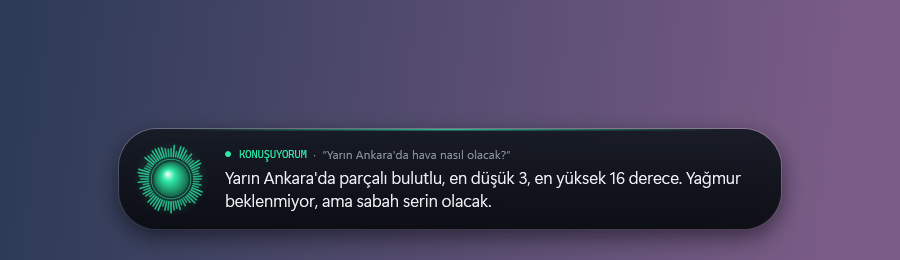

# Friday

Friday, Windows için Türkçe konuşan, **seni sürekli dinlemeyen** kişisel bir sesli asistan. Kısayola basınca mikrofonu açar, sen susunca kapatır. Konuşma tanıma, anlama, düşünme ve konuşma tamamen bilgisayarında çalışır; API anahtarı, abonelik ya da internet gerekmez.



## Onu farklı kılan şeyler

| | |
|---|---|
| **Ekranını görür** | "Bu hata ne?", "Ekranımda ne var?" deyince aktif pencerenin görüntüsünü alır ve Gemma 4'ün görme yeteneğiyle bilgisayarında yorumlar. Görüntü diske yazılmaz. |
| **Pano büyüsü** | Bir metni kopyala, "özetle", "İngilizceye çevir", "yazımını düzelt" ya da "resmileştir" de. Sonuç panoya geri konur; Ctrl+V ile yapıştırırsın. |
| **Kalıcı hafıza** | "Unutma, arabamın muayenesi 20 Kasım'da." Haftalar sonra da hatırlar; sabah brifinginde yaklaşanları söyler. Panelden görebilir, silebilirsin. |
| **Dosya radarı** | "Dün indirdiğim PDF'i bul", "içinde fatura geçen Excel'i aç". Windows Arama dizinini kullanır. |
| **Gizlilik defteri** | Mikrofonun ne zaman ve ne kadar açık kaldığı, neyin bilgisayarda kaldığı ve neyin dışarı çıktığı zaman çizelgesinde görünür. "Seni dinlemiyorum" iddiası denetlenebilir. |
| **Rutinler** | "Çalışma modunu aç" deyince uygulamalar ve siteler açılır. "Günaydın" deyince tarih, hava, zamanlayıcılar ve yaklaşan hatırlatmalar okunur. |
| **"Bilgisayar neden yavaş?"** | İşlemci, bellek, disk ve ekran kartını ölçer; en çok kaynak yiyen uygulamaları söyler. |
| **"Şu an ne çalıyor?"** | Spotify ya da tarayıcıdaki YouTube'da çalan şarkıyı Windows'tan okur; müziği durdurur ya da geçer. |
| **"Bugün ne konuştuk?"** | Günlük sohbet geçmişini bilgisayarında tutar ve özetler. |
| **LinguaFlow bağlantısı** | "Bu videoyu çevir" deyince [LinguaFlow](https://github.com/kursatcnk/LinguaFlow) açılır ve canlı çeviri başlar. |
| **Devam sorusu** | Cevaptan sonra mikrofon 4 sn daha açık kalır; tuşa basmadan "peki yarın?" diye sorabilirsin. Ayarlardan kapatılır. |
| **Kesme** | Friday konuşurken kısayola basarsan susar ve seni dinlemeye başlar. |
| **Yazarak sorma** | Konuşamadığın yerde panelden yazabilirsin. |

Tehlikeli işler bilerek yok: Friday dosya silemez, bilgisayarı kapatamaz, komut çalıştıramaz.

## Nasıl çalışır?

```
Ctrl+Alt+F      ──►  modeller uyuyorsa yüklenmeye başlar (sen konuşurken biter)
                     mikrofon AÇILIR · bip · kapsül belirir
                     │  16 kHz mono ses, yalnızca bellekte
                     ▼
                Konuşma bitti mi?  (900 ms sessizlik → mikrofon KAPANIR)
                     │
                     ▼
                Whisper Large v3 Turbo, GPU (Vulkan)          → "yarın ankara'da hava nasıl"
                     │
                     ▼
                Gemma 4 (Ollama, yerel) + 18 araç             → hava_durumu(sehir: "Ankara")
                     │   ▲                                       │
                     │   └──── araç sonucu ◄─────────────────────┘
                     ▼
                Cevap akarken cümlelere bölünür, sayılar ve yabancı adlar okunuşa çevrilir
                     │
                     ▼
                Piper Türkçe ses + oda/sıcaklık işlemi        → hoparlör
                     │
                     ▼
                4 sn devam sorusu beklenir · 5 dk boşta kalınca GPU boşaltılır
```

Her sesli asistan dört parçadan oluşur:

| Parça | Görevi | Friday'de |
|---|---|---|
| **Tetikleme** | Ne zaman dinleyeceğini bilmek | Genel kısayol (`RegisterHotKey`); mikrofon yalnızca o an açılır |
| **Kulak (STT)** | Sesi yazıya çevirmek | [Whisper.net](https://github.com/sandrohanea/whisper.net), Large v3 Turbo, GPU'da ~0,3 sn |
| **Beyin (LLM)** | Anlamak ve iş yapmak | [Ollama](https://ollama.com) + Gemma 4 E4B, araç çağırma (tool calling) |
| **Ses (TTS)** | Cevabı okumak | [Piper](https://github.com/rhasspy/piper) + [Türkçe ses](https://huggingface.co/99eren99/piper-turkish-tts), işlemcide anında · isteğe bağlı XTTS v2 ya da Azure |

### Neden sürekli dinlemiyor?

"Hey Siri" tarzı uyandırma sözcüğü, mikrofonun **her an açık** olmasını gerektirir. Friday kısayol kullanır: tuşa basmadığın sürece mikrofon cihazı hiç açılmaz, Windows'un mikrofon simgesi de görünmez. Mikrofon açıkken kapsülde kırmızı **"Mikrofon açık"** göstergesi yanar; her açılış gizlilik defterine yazılır.

### Araç çağırma (beyin nasıl iş yapıyor?)

Dil modeline 18 aracın listesi JSON şeması olarak verilir. "Not defterini aç" duyunca metin yerine `uygulama_ac(ad: "not defteri")` üretir; Friday aracı çalıştırır, sonucu modele verir, model "Açtım." der. Gemma 4, düşünme adımı kapalıyken aracı çağırmak yerine "aracı kullanacağım" diye anlatıyor. Bu yüzden kısa bir düşünme adımı açık; kısa sorulara ~0,5 sn ekliyor ve düşünce metni seslendirilmiyor.

## Ekran kartı belleği

Friday 8 GB'lık bir kartta **boştayken 0 GB, konuşurken ~4 GB** kullanır:

- **Görme modülü ayrı.** Sohbet, Gemma 4'ün görme modülü olmayan varyantıyla (`friday-text`) yapılır: 4,7 GB yerine 3,5 GB. Aynı model dosyasını paylaşır, diskte ek yer kaplamaz ve ilk açılışta otomatik oluşturulur. Görme modülü yalnızca "ekrana bak" denince yüklenir ve iş bitince boşaltılır.
- **Boşta uyku.** 5 dakika kullanılmazsa dil modeli ve Whisper GPU'dan çıkar.
- **Ön ısıtma.** Kısayola basınca modeller hemen yüklenmeye başlar. Yükleme (~3 sn) sen konuşurken biter, bu yüzden uyandırma neredeyse hissedilmez.
- **Ses GPU kullanmaz.** Piper işlemcide çalışır (bir cümle ~0,03 sn).
- **Talimat önbelleği korunur.** Sistem talimatında saat değil yalnızca tarih var; böylece Ollama ~2.000 belirteçlik talimatı her soruda yeniden işlemez.

Ölçüm (RTX 3070): eskiden sürekli ~5,2 GB; şimdi konuşurken ~4,0 GB, boşta kalınca 0 GB. İlk ses, soru bittikten ~1,7–2,5 sn sonra gelir.

## Ses

Varsayılan ses, Türkçe verilerle eğitilmiş [topluluk Piper modeli](https://huggingface.co/99eren99/piper-turkish-tts). İşlemcide anında çalışır, ekran kartı kullanmaz. Sentetik hissini azaltmak için:

- **Değişken tonlama.** Hece süreleri ve ton daha serbest (`PiperNoiseW` 0,9, `PiperNoiseScale` 0,667). Fazla düzenli ritim sesi mekanik duyurur.
- **Hafif oda ve sıcaklık** (`VoiceRoom` 0,07). Uğultu süzülür, alçak frekanslara biraz gövde eklenir, çok hafif bir oda yankısı katılır. Tamamen "kuru" ses kulağa yapay gelir.
- **Doğal örnekleme hızı.** Piper'ın 22 kHz çıkışı yeniden örneklenmeden çalınır.

Bu ayarlar, aynı metnin dört varyantı dinlenerek seçildi. `0` değeriyle kapatılabilir.

Seçenekler (Ayarlar → Ses):

| Motor | Nasıl | VRAM | Not |
|---|---|---|---|
| **Piper** (varsayılan) | Yerel, işlemci | 0 | Anında konuşur |
| **XTTS v2** | Yerel, GPU (`setup-xtts.ps1`, ~5 GB indirme) | konuşurken ~1,8 GB | İstediğin sesi 6–15 sn'lik bir kayıttan klonlar (`XttsVoiceSample`). Hazır sesleri İngilizce konuşan kişilere ait olduğundan hafif aksanlı. Model lisansı ticari olmayan kullanım içindir. |
| **Azure nöral** | Bulut, ücretsiz F0 anahtarı | 0 | En doğal Türkçe (Emel, Ahmet). Okunacak metin Microsoft'a gider, gizlilik defterine yazılır. |

Azure anahtarı için: [portal.azure.com](https://portal.azure.com) → **Speech service** (*Free F0*, *West Europe*) → **Keys and Endpoint** → **KEY 1** → Friday → Ayarlar.

Yabancı adlar Türkçe sesle yanlış okunmasın diye seslendirmeden önce okunuşlarına çevrilir (Claude → "Klod", YouTube → "Yutub", Chrome → "Krom"…). Sözlüğe `settings.json` içindeki `Pronunciations` bölümünden ekleme yapabilirsin.

## Kurulum

Gereksinimler: Windows 10/11 x64, [.NET 10 SDK](https://dotnet.microsoft.com/download/dotnet/10.0), en az 8 GB VRAM'li bir GPU önerilir (RTX 3070'te test edildi).

```powershell
.\setup.ps1   # Ollama, Piper, Türkçe ses ve Gemma 4'ü D:\Friday altına indirir (~7 GB, tek seferlik)
.\build.ps1   # derleme + testler
.\run.ps1     # Friday'i başlatır

.\setup-xtts.ps1   # isteğe bağlı: XTTS ses klonlama (Python + PyTorch + model, ~5 GB)
```

**C: sürücüsüne hiçbir şey kurulmaz.** Ollama kurulum sihirbazıyla değil, taşınabilir zip olarak açılır. Friday Ollama'yı kendisi başlatır ve ortam değişkenlerini yalnızca o alt süreç için ayarlar; Ollama'nın modelleri ve `.ollama` klasörü de D:'de kalır. Sistemde başka bir Ollama varsa çakışmaz (Friday 11435 portunu kullanır).

| Klasör | İçerik |
|---|---|
| `D:\Friday\tools` | Ollama ve Piper (taşınabilir) |
| `D:\Friday\models` | Gemma 4 (~6 GB), Türkçe Piper sesi |
| `D:\LinguaFlowModels` | Whisper, LinguaFlow ile paylaşılır (yoksa `D:\Friday\models\whisper`) |
| `D:\Friday\data` | `settings.json`, `memory.json`, gizlilik defteri (`ledger\`), sohbet geçmişi (`history\`) |
| `D:\CodexCache\Friday` | .NET/NuGet önbelleği |

## Kullanım

1. `.\run.ps1` ile başlat; ~8 sn sonra durum **Hazır** olur.
2. **Ctrl+Alt+F**'e bas, bipten sonra konuş ve sus. Bu kısayol başka bir uygulamadaysa Friday sırayla Ctrl+Alt+J, Ctrl+Shift+Space ve Win+Shift+F'yi dener ve hangisini kullandığını panelin sağ üstünde gösterir.
3. Ekranın altında cam bir kapsül belirir. Halkanın rengi durumu gösterir: **kırmızı** dinliyor, **mor** düşünüyor, **yeşil** konuşuyor. Kapsül tıklamaları geçirir, odağı çalmaz ve ekran görüntülerine girmez.
4. Pencereyi kapatınca Friday sistem tepsisine küçülür ve kısayol çalışmaya devam eder. Çıkmak için tepsi simgesine sağ tıkla → **Çıkış**.


## Ayarlar

Panelin **Ayarlar** bölümünden ya da `D:\Friday\data\settings.json` dosyasından (yeni sürümde eklenen ayarlar dosyaya kendiliğinden yazılır):

| Ayar | Varsayılan | Açıklama |
|---|---|---|
| `UserName` | boş | Sana nasıl hitap edeceği |
| `Personality` | `esprili` | `esprili`, `sade` ya da `resmi` |
| `Hotkey` | `Ctrl+Alt+F` | `Ctrl`/`Alt`/`Shift`/`Win` + tuş |
| `FollowUpSeconds` | `4` | Cevaptan sonra devam sorusu bekleme süresi; `0` kapatır |
| `SpeechEngine` | `piper` | `piper`, `xtts` ya da `azure` |
| `PiperNoiseScale` / `PiperNoiseW` / `VoiceRoom` | `0.667` / `0.9` / `0.07` | Ton ve ritim değişkenliği, oda ve sıcaklık |
| `XttsSpeaker` / `XttsVoiceSample` | `Ana Florence` / boş | XTTS sesi ya da klonlanacak .wav kaydı |
| `AzureSpeechKey` / `AzureSpeechRegion` / `AzureVoice` | boş / `westeurope` / `tr-TR-EmelNeural` | Doğal ses |
| `Pronunciations` | boş | Ek okunuşlar, ör. `{"Kubernetes": "Kubernetis"}` |
| `OllamaModel` / `VisionModel` | `friday-text` / `gemma4:e4b` | Sohbet ve görme modelleri |
| `GpuIdleMinutes` | `5` | Bu kadar boşta kalınca GPU boşaltılır |
| `City` | `İstanbul` | Hava durumunda şehir söylenmezse |
| `KeepHistory` | `true` | Günlük sohbet geçmişi |
| `LinguaFlowPath` | LinguaFlow yayını | "Bu videoyu çevir" komutu |
| `Routines` | çalışma modu, günaydın, mola | Adımlar: `uygulama:`, `site:`, `ara:`, `medya:`, `soyle:`, `ozet`, `linguaflow` |
| `Apps` | not defteri, hesap makinesi… | Sesli ad → komut; olmayanlar Başlat menüsünde aranır |

## Gizlilik

- Mikrofon yalnızca kısayoldan sonra, bir soru boyunca açılır. Ses bellekte işlenir, diske yazılmaz, hiçbir yere gönderilmez.
- Konuşma tanıma, dil modeli, ekran yorumlama ve pano işlemleri tamamen yereldir.
- Dışarı yalnızca şunlar çıkar ve hepsi gizlilik defterine yazılır: Azure açıksa okunacak cevap metni; hava durumu sorulursa şehir adı (Open-Meteo); açmasını istediğin siteler ve aramalar (tarayıcın üzerinden).

## Geliştirme

```
src/Friday.Core            Saf mantık: konuşma sonu algılama, cümle bölme, sayı ve okunuş çevirisi,
                           hafıza, gizlilik defteri, sohbet geçmişi, rutinler, dosya arama sorgusu, talimatlar
src/Friday.Infrastructure  Mikrofon, Whisper, Ollama sunucusu/istemcisi, Azure + Piper ses, 18 araç, asistan döngüsü
src/Friday.Desktop         Cam kapsül HUD, ses halkası, kontrol paneli, genel kısayol, sistem tepsisi
tests/Friday.UnitTests     Birim testleri
```

Arayüzü uygulamayı çalıştırmadan örnek verilerle PNG olarak çizmek için:

```powershell
.\src\Friday.Desktop\bin\Release\net10.0-windows10.0.19041.0\win-x64\Friday.exe --snapshot work\snapshots
```
