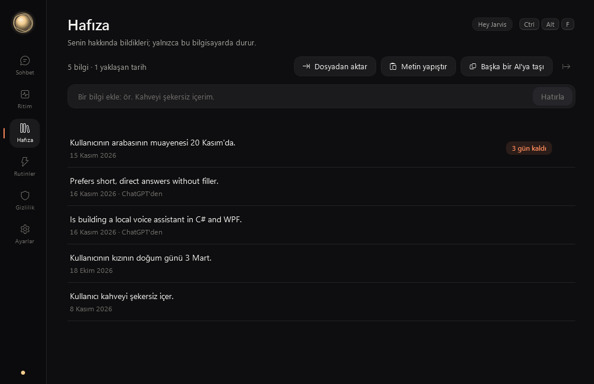
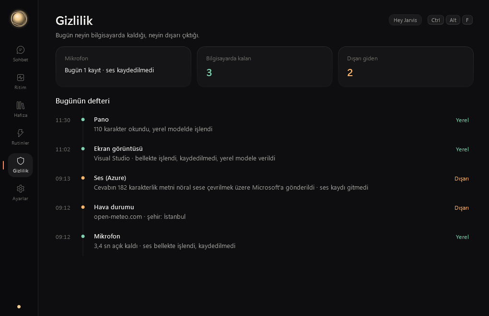

# Friday

Friday, Windows için Türkçe konuşan kişisel bir sesli asistan. **"Hey Jarvis"** deyince ya da kısayola basınca dinlemeye başlar, sen susunca durur. Uyandırma kelimesi, konuşma tanıma, anlama, düşünme ve konuşma tamamen bilgisayarında çalışır; API anahtarı, abonelik ya da internet gerekmez. Boşta beklerken toplam ~60 MB RAM ve tek çekirdeğin ~%2'sini kullanır.


## Onu farklı kılan şeyler

| | |
|---|---|
| **"Hey Jarvis"** | Elin klavyede değilken seslenmen yeterli. Kelime [openWakeWord](https://github.com/dscripka/openWakeWord) ile bilgisayarında, işlemcide aranır; ses kaydedilmez. Ayarlardan kapatılır. |
| **Ekranını görür** | "Bu hata ne?", "Ekranımda ne var?" deyince aktif pencerenin görüntüsünü alır ve Gemma 4'ün görme yeteneğiyle bilgisayarında yorumlar. Görüntü diske yazılmaz. |
| **Pano büyüsü** | Bir metni kopyala, "özetle", "İngilizceye çevir", "yazımını düzelt" ya da "resmileştir" de. Sonuç panoya geri konur; Ctrl+V ile yapıştırırsın. |
| **Ritim koçu** | Kaç dakikadır aralıksız çalıştığını bilir; yazarken değil bir duraksamada, tam ekran oyun ya da film açık değilken mola önerir. Her seferinde başka bir öneri gelir: 20 saniye sayarak göz molası, rehberli esneme, su (içtiklerini sayar), uzun oturumda yürüyüş, gece geç saatte günü kapatma. "Nefes egzersizi" deyince seni sesli yönlendirir, "25 dakika odaklanacağım" deyince odak oturumu açar. |
| **Kaldığın yer** | Moladan dönünce "Tekrar hoş geldin, 6 dakika mola verdin. Kaldığın yer: Visual Studio Code, FridayAssistant.cs." der. "Nerede kalmıştım?" diye de sorabilirsin. |
| **Sabah karşılaması** | Günün ilk oturuşunda havayı ve yaklaşan tarihleri kısaca söyler. |
| **Kalıcı hafıza** | "Unutma, arabamın muayenesi 20 Kasım'da." Haftalar sonra da hatırlar; tarihli bilgilerde "3 gün kaldı" diye sayar ve sabah söyler. |
| **Hafızanı taşı** | ChatGPT'nin, Claude'un ya da Gemini'nin hafıza listesini .txt, .md ya da .json olarak içe aktar (ya da yapıştır); önizlemede seç, Friday zaten bildiklerini işaretler. Tersine, Friday'in hafızasını tek tıkla başka bir yapay zekâya yapıştırılacak bir mesaja ya da Markdown dosyasına çevir. |
| **Dosya radarı** | "Dün indirdiğim PDF'i bul", "içinde fatura geçen Excel'i aç". Windows Arama dizinini kullanır. |
| **Gizlilik defteri** | Mikrofonun ne zaman ve ne kadar açık kaldığı, neyin bilgisayarda kaldığı ve neyin dışarı çıktığı zaman çizelgesinde görünür. "Seni dinlemiyorum" iddiası denetlenebilir. |
| **Rutinler** | "Çalışma modunu aç" deyince uygulamalar ve siteler açılır. "Günaydın" deyince tarih, hava, zamanlayıcılar ve yaklaşan hatırlatmalar okunur. |
| **"Bilgisayar neden yavaş?"** | İşlemci, bellek, disk ve ekran kartını ölçer; en çok kaynak yiyen uygulamaları söyler. |
| **"Şu an ne çalıyor?"** | Spotify ya da tarayıcıdaki YouTube'da çalan şarkıyı Windows'tan okur; müziği durdurur ya da geçer. |
| **"Bugün ne konuştuk?"** | Günlük sohbet geçmişini bilgisayarında tutar ve özetler. |
| **LinguaFlow bağlantısı** | "Bu videoyu çevir" deyince [LinguaFlow](https://github.com/kursatcnk/LinguaFlow) açılır ve canlı çeviri başlar. |
| **Devam sorusu** | Cevaptan sonra mikrofon 4 sn daha açık kalır; tuşa basmadan "peki yarın?" diye sorabilirsin. Ayarlardan kapatılır. |
| **Kesme** | Friday konuşurken kısayola basarsan ya da "Hey Jarvis" dersen susar ve seni dinlemeye başlar. |
| **Yazarak sorma** | Konuşamadığın yerde panelden yazabilirsin. |

Tehlikeli işler bilerek yok: Friday dosya silemez, bilgisayarı kapatamaz, komut çalıştıramaz.

## Nasıl çalışır?

```
"Hey Jarvis"
ya da Ctrl+Alt+F ─►  modeller uyuyorsa yüklenmeye başlar (sen konuşurken biter)
                     mikrofon AÇILIR · bip · kapsül belirir
                     │  16 kHz mono ses, yalnızca bellekte
                     ▼
                Konuşma bitti mi?  (900 ms sessizlik → mikrofon KAPANIR)
                     │
                     ▼
                Whisper Large v3 Turbo, GPU (Vulkan)          → "yarın ankara'da hava nasıl"
                     │
                     ▼
                Gemma 4 (Ollama, yerel) + 18 araç             → hava_durumu(sehir: "Ankara")
                     │   ▲                                       │
                     │   └──── araç sonucu ◄─────────────────────┘
                     ▼
                Cevap akarken cümlelere bölünür, sayılar ve yabancı adlar okunuşa çevrilir
                     │
                     ▼
                Piper Türkçe ses + oda/sıcaklık işlemi        → hoparlör
                     │
                     ▼
                4 sn devam sorusu beklenir · 2 dk boşta kalınca GPU ve RAM boşaltılır
```

Her sesli asistan dört parçadan oluşur:

| Parça | Görevi | Friday'de |
|---|---|---|
| **Tetikleme** | Ne zaman dinleyeceğini bilmek | "Hey Jarvis" ([openWakeWord](https://github.com/dscripka/openWakeWord), ONNX Runtime, işlemci) ya da genel kısayol (`RegisterHotKey`) |
| **Kulak (STT)** | Sesi yazıya çevirmek | [Whisper.net](https://github.com/sandrohanea/whisper.net), Large v3 Turbo, GPU'da ~0,3 sn |
| **Beyin (LLM)** | Anlamak ve iş yapmak | [Ollama](https://ollama.com) + Gemma 4 E4B, araç çağırma (tool calling) |
| **Ses (TTS)** | Cevabı okumak | [Piper](https://github.com/rhasspy/piper) + [Türkçe ses](https://huggingface.co/99eren99/piper-turkish-tts), işlemcide anında · isteğe bağlı XTTS v2 ya da Azure |

### "Hey Jarvis" nasıl çalışıyor?

Uyandırma kelimesi, mikrofonun **her an açık** olmasını gerektirir; bu yüzden Windows'un mikrofon simgesi görünür. Ses 80 ms'lik parçalar halinde yalnızca bellekte işlenip hemen atılır, diske yazılmaz, hiçbir yere gönderilmez. Üç küçük model (toplam 3,6 MB) zinciri her parçayı puanlar: mel spektrogram → konuşma gömmesi → "hey jarvis" sınıflandırıcı.

- **Yanlış uyanmaya karşı.** Gerçek "Hey Jarvis" art arda 2–9 parça boyunca yüksek puan alır; benzer sesli cümlelerin çoğu tek parçada kalır. Friday iki parça şartı arar (gecikmeye 80 ms ekler).
- **Sessizlikte bedava.** Oda 1,3 sn'den uzun sessizse modeller hiç çalışmaz; arabellekler sessizliğin önceden hesaplanmış karşılığıyla kaydırılır. Ses gelince ilk parçada tam işlemeye dönülür.
- **Ölçüm.** Konuşma varken 80 ms'lik parça başına ~0,7–1,1 ms işlemci; boşta Friday'in tamamı tek çekirdeğin ~%1,8'i.
- **Türkçe aksan.** "Hey Carvis" gibi söylemek yeterli. Türkçe J ile ("jurnal"daki gibi) söylenirse tanımaz.
- **Kapatmak için** `WakeWord` ayarını boş bırak; mikrofon o zaman yalnızca kısayoldan sonra açılır ve simge de görünmez. Mikrofon bir soru için açıkken kapsülde kırmızı **"Mikrofon açık"** göstergesi yanar; her açılış gizlilik defterine yazılır.

Hazır "hey jarvis" modeli openWakeWord projesine aittir ve ticari olmayan kullanım lisanslıdır (CC BY-NC-SA 4.0).

### Araç çağırma (beyin nasıl iş yapıyor?)

Dil modeline 18 aracın listesi JSON şeması olarak verilir. "Not defterini aç" duyunca metin yerine `uygulama_ac(ad: "not defteri")` üretir; Friday aracı çalıştırır, sonucu modele verir, model "Açtım." der. Gemma 4, düşünme adımı kapalıyken aracı çağırmak yerine "aracı kullanacağım" diye anlatıyor. Bu yüzden kısa bir düşünme adımı açık; kısa sorulara ~0,5 sn ekliyor ve düşünce metni seslendirilmiyor.

## Hız

Günlük komutların çoğu kalıptır ve dil modeline hiç gitmez: saat ve tarih, hava durumu ("yarın İzmir'de yağmur yağacak mı?"), döviz, müzik ve ses, zamanlayıcı ("10 dakika sonra çayı hatırlat"), uygulama açma, rutinler ve ritim komutları. Bunlar veriden kurulan doğal bir cümleyle **0,1–0,5 sn'de** cevaplanır; model bu sorularda önce düşünüp sonra araç çağırdığı için 3–13 sn harcıyordu.

- **Tahmini yazıya dökme.** Sen yarım saniye susunca o ana kadar söylediğin yazıya dökülür. Tamamlanmış bir komut ya da soruysa Friday 1,2 sn'lik sessizliği beklemeden cevap verir; değilse yazı hazır bekler.
- **Düşünme yalnızca gerektiğinde.** Model, hangi aracı çağıracağına karar verirken düşünür; selamlaşma, espri ya da araç sonucunu cümleye dökerken düşünmez.
- **Döviz yarışı.** TCMB bülteni bazen 9 sn'de geliyor; TCMB ve piyasa ortalaması aynı anda istenir, önce gelen kullanılır, 15 dk saklanır.
- **Hızlı açılış.** NVIDIA kartı olan bilgisayarlarda Ollama'nın Vulkan taraması atlanır (~8 sn).

| Soru | Önce (ilk ses) | Şimdi |
|---|---|---|
| "Saat kaç?" | 2,8 sn | anında |
| "Bugün hava nasıl?" | 4,1 sn | 0,1 sn |
| "Dolar kaç lira?" | 9 sn'ye kadar | 0,2–0,5 sn |
| "Bana kısa bir espri yap." | 2,3 sn | 0,3 sn (model hazırken) |

## Bellek ve ekran kartı

Friday boşta **toplam ~60 MB RAM ve 0 GB VRAM**, konuşurken ~3,5 GB RAM ve ~4 GB VRAM kullanır:

- **Boşta neredeyse hiçbir şey kalmaz.** 2 dakika kullanılmazsa dil modeli (RAM'deki ~3,2 GB'lık gömme tablolarıyla birlikte), Whisper ve Piper kapanır; Friday yönetilen yığını sıkıştırıp çalışma kümesini işletim sistemine geri verir. Ölçüm: Friday 38 MB + Ollama sunucusu 21 MB.
- **Neden konuşurken 3 GB RAM?** Gemma 4 E4B'nin katman başına gömme tabloları tasarım gereği işlemci belleğinde durur. Diskten eşleyerek yüklemek RAM'i 0,5 GB'a indiriyor ama yüklemeyi 3 sn'den 46 sn'ye çıkarıyor; bu yüzden onun yerine model boşta erken kapatılır.
- **Halka animasyonu** panel öndeyken saniyede 15 kare nefes alır, arka plandayken hiç çizilmez.

- **Görme modülü ayrı.** Sohbet, Gemma 4'ün görme modülü olmayan varyantıyla (`friday-text`) yapılır: 4,7 GB yerine 3,5 GB. Aynı model dosyasını paylaşır, diskte ek yer kaplamaz ve ilk açılışta otomatik oluşturulur. Görme modülü yalnızca "ekrana bak" denince yüklenir ve iş bitince boşaltılır.
- **Ön ısıtma.** "Hey Jarvis" duyulunca ya da kısayola basınca modeller hemen yüklenmeye başlar. Yükleme (~3 sn) sen konuşurken biter, bu yüzden uyandırma neredeyse hissedilmez.
- **Ses GPU kullanmaz.** Piper işlemcide çalışır (bir cümle ~0,03 sn).
- **Talimat önbelleği korunur.** Sistem talimatında saat değil yalnızca tarih var; böylece Ollama ~2.000 belirteçlik talimatı her soruda yeniden işlemez.

Ölçüm (RTX 3070): eskiden sürekli ~5,2 GB; şimdi konuşurken ~4,0 GB, boşta kalınca 0 GB. İlk ses, soru bittikten ~1,7–2,5 sn sonra gelir.

## Ses

Varsayılan ses, Türkçe verilerle eğitilmiş [topluluk Piper modeli](https://huggingface.co/99eren99/piper-turkish-tts). İşlemcide anında çalışır, ekran kartı kullanmaz. Sentetik hissini azaltmak için:

- **Değişken tonlama.** Hece süreleri ve ton daha serbest (`PiperNoiseW` 0,9, `PiperNoiseScale` 0,667). Fazla düzenli ritim sesi mekanik duyurur.
- **Hafif oda ve sıcaklık** (`VoiceRoom` 0,07). Uğultu süzülür, alçak frekanslara biraz gövde eklenir, çok hafif bir oda yankısı katılır. Tamamen "kuru" ses kulağa yapay gelir.
- **Doğal örnekleme hızı.** Piper'ın 22 kHz çıkışı yeniden örneklenmeden çalınır.

Bu ayarlar, aynı metnin dört varyantı dinlenerek seçildi. `0` değeriyle kapatılabilir.

Seçenekler (Ayarlar → Ses):

| Motor | Nasıl | VRAM | Not |
|---|---|---|---|
| **Piper** (varsayılan) | Yerel, işlemci | 0 | Anında konuşur |
| **XTTS v2** | Yerel, GPU (`setup-xtts.ps1`, ~5 GB indirme) | konuşurken ~1,8 GB | İstediğin sesi 6–15 sn'lik bir kayıttan klonlar (`XttsVoiceSample`). Hazır sesleri İngilizce konuşan kişilere ait olduğundan hafif aksanlı. Model lisansı ticari olmayan kullanım içindir. |
| **Azure nöral** | Bulut, ücretsiz F0 anahtarı | 0 | En doğal Türkçe (Emel, Ahmet). Okunacak metin Microsoft'a gider, gizlilik defterine yazılır. |

Azure anahtarı için: [portal.azure.com](https://portal.azure.com) → **Speech service** (*Free F0*, *West Europe*) → **Keys and Endpoint** → **KEY 1** → Friday → Ayarlar.

Yabancı adlar Türkçe sesle yanlış okunmasın diye seslendirmeden önce okunuşlarına çevrilir (YouTube → "Yutub", Chrome → "Krom", Spotify → "Spotifay"…). Sözlüğe `settings.json` içindeki `Pronunciations` bölümünden ekleme yapabilirsin.

## Kurulum

Gereksinimler: Windows 10/11 x64, [.NET 10 SDK](https://dotnet.microsoft.com/download/dotnet/10.0), en az 8 GB VRAM'li bir GPU önerilir (RTX 3070'te test edildi).

```powershell
.\setup.ps1   # Ollama, Piper, Türkçe ses, "Hey Jarvis" ve Gemma 4'ü D:\Friday altına indirir (~7 GB, tek seferlik)
.\build.ps1   # derleme + testler
.\run.ps1     # Friday'i başlatır

.\setup-xtts.ps1   # isteğe bağlı: XTTS ses klonlama (Python + PyTorch + model, ~5 GB)
```

**C: sürücüsüne hiçbir şey kurulmaz.** Ollama kurulum sihirbazıyla değil, taşınabilir zip olarak açılır. Friday Ollama'yı kendisi başlatır ve ortam değişkenlerini yalnızca o alt süreç için ayarlar; Ollama'nın modelleri ve `.ollama` klasörü de D:'de kalır. Sistemde başka bir Ollama varsa çakışmaz (Friday 11435 portunu kullanır).

| Klasör | İçerik |
|---|---|
| `D:\Friday\tools` | Ollama ve Piper (taşınabilir) |
| `D:\Friday\models` | Gemma 4 (~6 GB), Türkçe Piper sesi, "Hey Jarvis" modelleri (`wakeword\`) |
| `D:\LinguaFlowModels` | Whisper, LinguaFlow ile paylaşılır (yoksa `D:\Friday\models\whisper`) |
| `D:\Friday\data` | `settings.json`, `memory.json`, gizlilik defteri (`ledger\`), sohbet geçmişi (`history\`), hata günlüğü (`logs\`, 14 gün) |
| `D:\CodexCache\Friday` | .NET SDK ev klasörü, NuGet paketleri, NuGet indirme önbelleği ve derlemenin geçici dosyaları |

## Kullanım

1. `.\run.ps1` ile başlat; ~8 sn sonra durum **Hazır** olur.
2. **"Hey Jarvis"** de ya da **Ctrl+Alt+F**'e bas, bipten sonra konuş ve sus. Bu kısayol başka bir uygulamadaysa Friday sırayla Ctrl+Alt+J, Ctrl+Shift+Space ve Win+Shift+F'yi dener ve hangisini kullandığını panelin sağ üstünde gösterir.
3. Ekranın altında cam bir kapsül belirir. Halkanın rengi durumu gösterir: **kırmızı** dinliyor, **mor** düşünüyor, **yeşil** konuşuyor. Kapsül tıklamaları geçirir, odağı çalmaz ve ekran görüntülerine girmez.
4. Pencereyi kapatınca (ya da tepsi simgesi → **Çıkış**) Friday tamamen kapanır: başlattığı Ollama, llama-server, Piper ve XTTS süreçleri kapatılır, kapanmayan varsa 5 sn içinde zorla sonlandırılır, D:\Friday\tools altından çalışan sahipsiz bir süreç kalmışsa o da kapatılır ve Friday'in kendi süreci kesin olarak biter; RAM ve VRAM'in tamamı geri döner. Friday Görev Yöneticisi'nden sonlandırılsa ya da çökse bile bu süreçler açık kalmaz, bir sonraki açılışta da önceki oturumdan kalan bir şey varsa temizlenir. Kısayolun çalışmaya devam etmesi için pencereyi kapatma, simge durumuna küçült. Friday zaten açıkken yeniden başlatırsan ikinci bir kopya açılmaz; çalışan Friday'in paneli öne gelir.
5. Beklenmeyen bir hata Friday'i kapatmaz; ayrıntısı `D:\Friday\data\logs` altındaki günlüğe yazılır. Ollama kapanırsa bir sonraki soruda kendiliğinden yeniden başlatılır.





## Ayarlar

Panelin **Ayarlar** bölümünden ya da `D:\Friday\data\settings.json` dosyasından (yeni sürümde eklenen ayarlar dosyaya kendiliğinden yazılır):

| Ayar | Varsayılan | Açıklama |
|---|---|---|
| `UserName` | boş | Sana nasıl hitap edeceği |
| `Personality` | `esprili` | `esprili`, `sade` ya da `resmi` |
| `Hotkey` | `Ctrl+Alt+F` | `Ctrl`/`Alt`/`Shift`/`Win` + tuş |
| `WakeWord` / `WakeWordThreshold` | `hey_jarvis` / `0.5` | Uyandırma kelimesi; boş bırakılırsa kapalı. Yanlışlıkla uyanıyorsa eşiği artır, duymuyorsa azalt |
| `FollowUpSeconds` | `4` | Cevaptan sonra devam sorusu bekleme süresi; `0` kapatır |
| `SpeechEngine` | `piper` | `piper`, `xtts` ya da `azure` |
| `PiperNoiseScale` / `PiperNoiseW` / `VoiceRoom` | `0.667` / `0.9` / `0.07` | Ton ve ritim değişkenliği, oda ve sıcaklık |
| `XttsSpeaker` / `XttsVoiceSample` | `Ana Florence` / boş | XTTS sesi ya da klonlanacak .wav kaydı |
| `AzureSpeechKey` / `AzureSpeechRegion` / `AzureVoice` | boş / `westeurope` / `tr-TR-EmelNeural` | Doğal ses |
| `Pronunciations` | boş | Ek okunuşlar, ör. `{"Kubernetes": "Kubernetis"}` |
| `OllamaModel` / `VisionModel` | `friday-text` / `gemma4:e4b` | Sohbet ve görme modelleri |
| `Rhythm` / `BreakEveryMinutes` / `BreakMinutes` | `true` / `50` / `5` | Ritim koçu, mola önerisi aralığı ve "mola ver" süresi |
| `MorningGreeting` | `true` | Günün ilk oturuşunda kısa karşılama |
| `GpuIdleMinutes` | `2` | Bu kadar boşta kalınca dil modeli, Whisper ve Piper kapanır (GPU ve RAM boşalır) |
| `City` | `İstanbul` | Hava durumunda şehir söylenmezse |
| `KeepHistory` | `true` | Günlük sohbet geçmişi |
| `LinguaFlowPath` | LinguaFlow yayını | "Bu videoyu çevir" komutu |
| `Routines` | çalışma modu, günaydın, mola | Adımlar: `uygulama:`, `site:`, `ara:`, `medya:`, `soyle:`, `ozet`, `linguaflow` |
| `Apps` | not defteri, hesap makinesi… | Sesli ad → komut; olmayanlar Başlat menüsünde aranır |

## Gizlilik

- "Hey Jarvis" açıkken mikrofon sürekli açıktır ama ses 80 ms'lik parçalar halinde yalnızca bellekte puanlanıp atılır. `WakeWord` boşsa mikrofon yalnızca kısayoldan sonra, bir soru boyunca açılır. Sorunun sesi de bellekte işlenir, diske yazılmaz, hiçbir yere gönderilmez.
- Konuşma tanıma, dil modeli, ekran yorumlama ve pano işlemleri tamamen yereldir.
- Ritim koçu yalnızca Windows'un tuttuğu "son klavye/fare kullanımı" zamanını okur; tuşlar, ekran ve pencere içerikleri okunmaz. Moladan önce yalnızca öndeki pencerenin başlığı hatırlanır. Günlük süreler `D:\Friday\data\rhythm` altında, 90 gün tutulur.
- Dışarı yalnızca şunlar çıkar ve hepsi gizlilik defterine yazılır: Azure açıksa okunacak cevap metni; hava durumu sorulursa şehir adı (Open-Meteo); açmasını istediğin siteler ve aramalar (tarayıcın üzerinden).

## Geliştirme

```
src/Friday.Core            Saf mantık: konuşma sonu algılama, cümle bölme, sayı ve okunuş çevirisi,
                           hafıza, gizlilik defteri, sohbet geçmişi, rutinler, dosya arama sorgusu, talimatlar
src/Friday.Infrastructure  Mikrofon, Whisper, Ollama sunucusu/istemcisi, Azure + Piper ses, 18 araç, asistan döngüsü
src/Friday.Desktop         Cam kapsül HUD, ses halkası, kontrol paneli, genel kısayol, sistem tepsisi
tests/Friday.UnitTests     Birim testleri
```

Arayüzü uygulamayı çalıştırmadan örnek verilerle PNG olarak çizmek için:

```powershell
.\src\Friday.Desktop\bin\Release\net10.0-windows10.0.19041.0\win-x64\Friday.exe --snapshot work\snapshots
```
